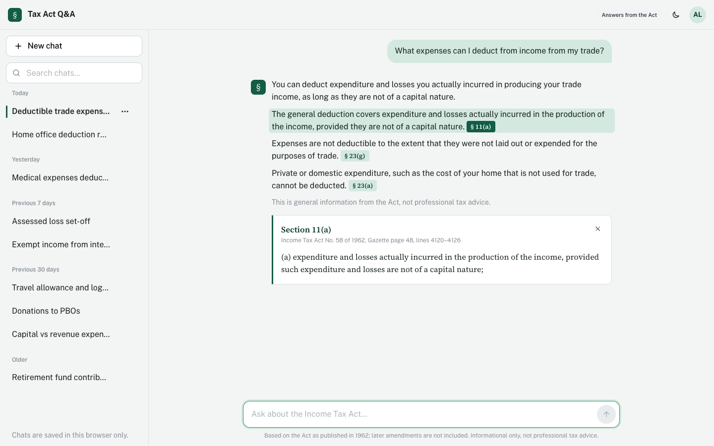
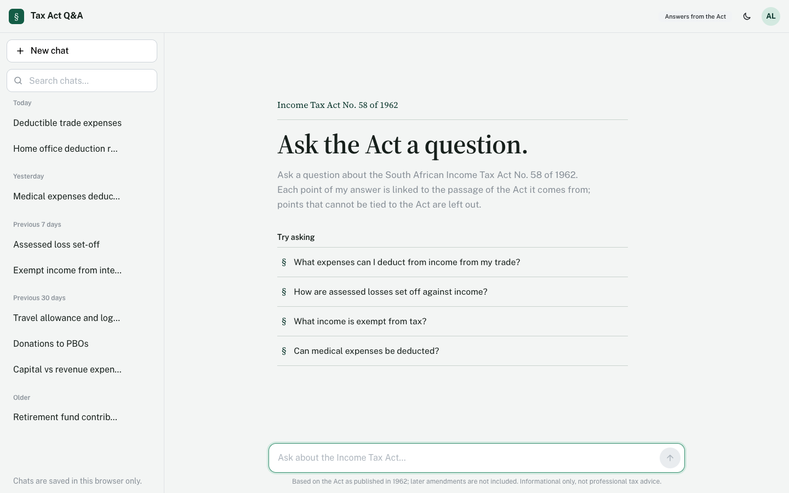
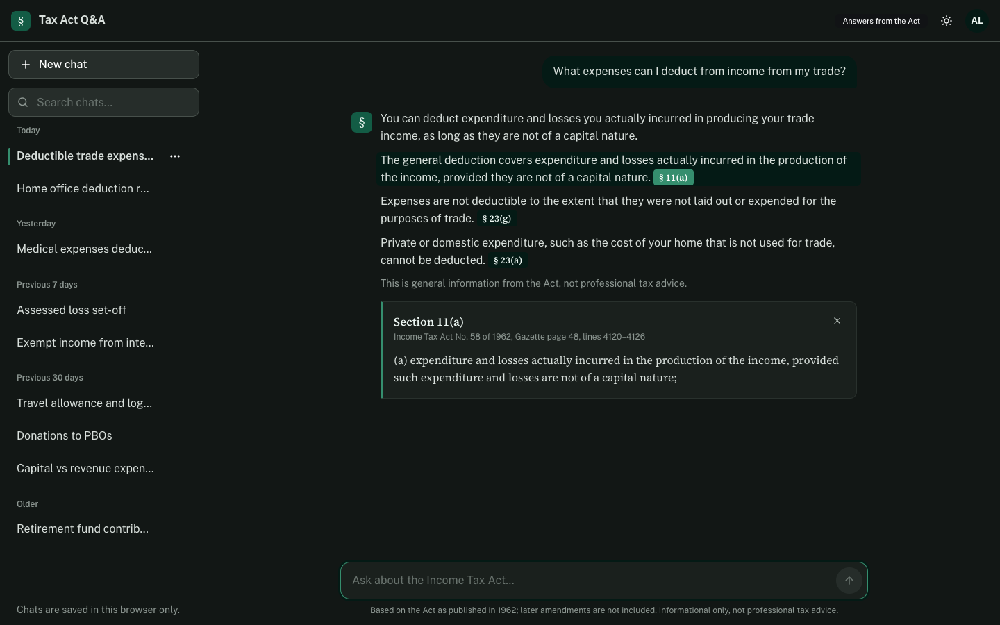
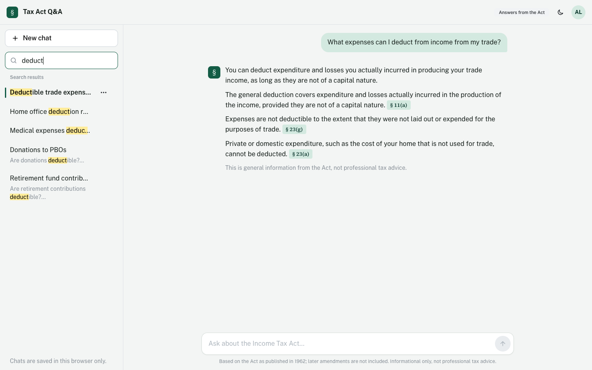
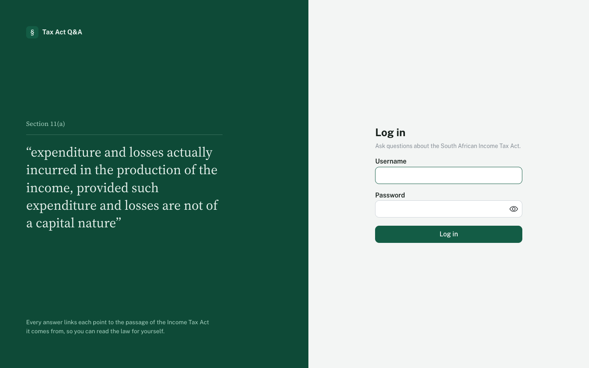
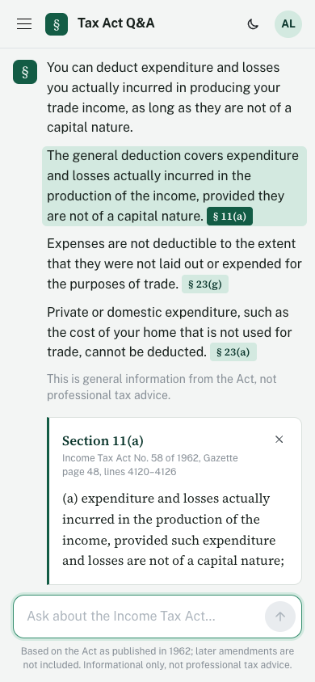

# SA Tax Chatbot

A chatbot that answers questions about the South African Income Tax,
plus offline tooling to fine-tune a local LLM on the Act and to scan bank statements for
likely tax deductions.

Answers come from one of two modes:
- **RAG** (default) — retrieves relevant excerpts from a vector index of the Act and
  answers from that context.
- **Fine-tuned** — uses a LoRA adapter trained on the Act instead of retrieval, when
  `TAX_MODEL_ADAPTER` points at a trained adapter directory.

This is informational only, not professional tax advice — always consult a registered
tax practitioner.

## Screenshots



| | |
|---|---|
| <br><sub>New chat</sub> | <br><sub>Dark mode</sub> |
| <br><sub>Searching saved chats</sub> | <br><sub>Sign in</sub> |



Screenshots use demo or dummy data.


## Project structure

```
backend/            Flask API
  app/
    config.py        env vars + shared paths
    routes/           HTTP layer (chat, health)
    services/          reusable logic (LLM, RAG, chat)
  scripts/            offline CLI tools (OCR, training, corpus-building, scanning)
  data/               Act text/PDF, sample CSV, vector index, trained models
  run.py              entry point
frontend/            React + Vite + TypeScript SPA (Mantine UI, Zustand, Axios)
```

## Running with Docker (Windows and macOS)

Docker keeps everything that differs between Windows and macOS (`node_modules`, Python packages, native binaries, downloaded models) inside images and Docker volumes. OneDrive then syncs only source code and data, so an update made on one machine runs on the other after one command. Needs Docker Desktop.

```bash
docker compose up -d --build      # http://localhost:8081
```

- **Model speed:** Docker on macOS can't use the Apple GPU, so the local model runs on the CPU. That is slow, and a 7B model needs about 16 GB of memory assigned to Docker (Docker Desktop: Settings, Resources). On a Mac, for speed, run the backend natively and only the frontend in Docker: `API_URL=http://host.docker.internal:5000 docker compose -f docker-compose.dev.yml up --build --no-deps frontend`.
- **NVIDIA GPU (Windows):** `docker compose -f docker-compose.yml -f docker-compose.gpu.yml up -d --build` uses CUDA PyTorch with 4-bit loading.
- **Data:** `backend/data` (the Act, the vector index, adapters, users and saved chats) is mounted from this folder, so OneDrive keeps syncing it. Downloaded Hugging Face models go in the `hf-cache` Docker volume, which is not synced.
- **Settings:** read from `backend/.env`. Docker's own device settings win over it.
- **Offline scripts:** `docker compose run --rm backend python scripts/<script>.py`.
- **Port:** `TAXBOT_PORT=9000 docker compose up -d`.
- **After pulling or syncing an update:** run `docker compose up -d --build` again; only the changed layers rebuild.
- **Logs:** `docker compose logs -f backend`. **Stop:** `docker compose down`.
- **Live reload while editing:** `docker compose -f docker-compose.dev.yml up --build`, then open http://localhost:5181. Code changes on either machine reload the running app. The frontend's `node_modules` lives in a Docker volume and is reinstalled only when `package-lock.json` changes.

## Backend setup

```
cd backend
python -m venv venv && venv\Scripts\activate   # or source venv/bin/activate on macOS/Linux
pip install -r requirements.txt
cp .env.example .env   # fill in OPENAI_API_KEY if you use the OpenAI-backed scripts
```

Build the RAG vector index once before chatting (needs `data/za-act-1962-58-publication-document.txt`):

```
python scripts/build_rag_index.py --build
```

Run the API:

```
python run.py
```

The API listens on `http://127.0.0.1:5000` with `GET /api/health` and `POST /api/chat`.

## Frontend setup

```
cd frontend
npm install
npm run dev
```

Opens on `http://localhost:5173` and proxies `/api` requests to the Flask backend on
port 5000 (see `vite.config.ts`).

## Offline scripts (run from `backend/`)

| Script | Purpose |
|---|---|
| `scripts/ocr_pdf.py` | OCR a scanned PDF into text (Tesseract + PyMuPDF) |
| `scripts/build_rag_index.py` | Build/query the ChromaDB vector index over the Act |
| `scripts/build_raw_corpus.py` | Build a raw text corpus for causal LM pretraining |
| `scripts/build_tax_training_data.py` | Build an instruction-tuning dataset from the Act |
| `scripts/train_causal_lm.py` | Pretrain a causal LM on the raw corpus |
| `scripts/train_tax_lora.py` | LoRA fine-tune a local model on the instruction dataset |
| `scripts/statement_generation.py` | Generate a synthetic SA bank statement CSV via OpenAI |
| `scripts/transaction_scanner.py` | Classify bank transactions for likely tax deductions |
| `scripts/chat_cli.py` | Interactive terminal chat session (no web UI) |

After training a LoRA adapter, set `TAX_MODEL_ADAPTER=data/tax_lora_adapter` (or your
adapter path) in `backend/.env` to switch the chatbot to fine-tuned mode.

## Configuration

See `backend/.env.example` for all supported environment variables (`OPENAI_API_KEY`,
`HF_MODEL`, `TAX_MODEL_ADAPTER`, `LOCAL_LLM_DEVICE`, `TAX_TRAIN_DEVICE`).
